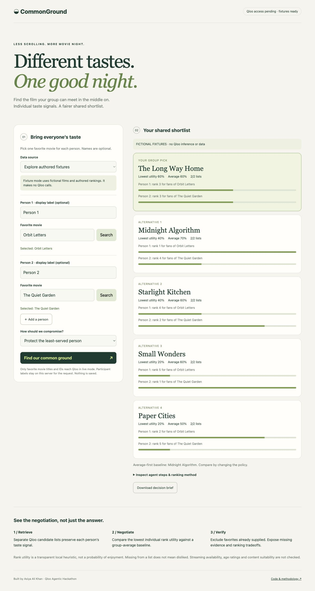

# CommonGround
### Different tastes. One good night.

An evidence-grounded group movie-night agent built for the **Qloo Agentic Hackathon** by **Asiya Ali Khan**. It retrieves a separate movie recommendation list for each participant, negotiates a shared shortlist, and exposes exactly who each choice serves.

**Status:** working local application and tested Qloo adapter. Public hosted demo: https://commonground-asiya.asiyaaaaa8.chatgpt.site . Live Qloo verification is pending API-key approval. Registration and API-key request were completed October 30, 2026. **This is not yet a completed hackathon submission.**



## Why another recommendation app?
A group average can hide one disappointed person. CommonGround makes that tradeoff visible: protect the least-served participant, compare against average-first ranking, and inspect per-person source ranks. It does not claim that a rank is a probability of enjoyment or that a compromise is objectively fair.

## Run in two commands
Python 3.10+; no dependencies or package install.

```sh
python3 server.py
# Open http://127.0.0.1:8790
```

Click **Try the fixture example**. These are fictional movies with authored rankings, not Qloo responses. A second person likes a different fictional film; the conservative policy prioritizes a broadly supported compromise over a polarizing average-first winner.

For live requests, set your own hackathon key **in the server environment**, never the browser or a tracked file:

```sh
export QLOO_API_KEY='your-key'
python3 server.py
```

Select **Live Qloo API**, search each person's favorite film, confirm a result, and run the agent. Live calls send titles and IDs to Qloo. A missing key or provider failure raises an explicit error; it never swaps in fixtures. Search and result schemas are contract-tested, but tests are not evidence of a real provider run.

## Agent workflow


The agent is a bounded deterministic tool workflow, not a conversational LLM. No language model is needed to manufacture explanations: each decision is explained by actual retrieved rank positions. At most eight provider requests per group plan (search verification and Insights for each of up to four people); no autonomous recursion or code execution.

## Ranking methodology
For an item at one-based position `r` in a list of length `n`, utility is `(n - r + 1) / n`. Missing items receive zero **for conservative ranking only**; absence is unknown evidence, not proof of dislike. The fair policy sorts by minimum utility, then average utility, then stable entity ID. The baseline reverses the first two criteria. All seed IDs are excluded.

This normalization is a local design choice. Returned lists may differ in length and coverage, so scores are not calibrated across users. No study has validated satisfaction or superiority over a generic LLM. The baseline compares two aggregation policies over the same Qloo candidates, not Qloo versus another provider.

## Qloo contract
- Hackathon origin: `https://hackathon.api.qloo.com`.
- Server-only `X-Api-Key` header, never URL parameters.
- `GET /search?query=...&types=urn:entity:movie&take=5`.
- `GET /v2/insights?filter.type=urn:entity:movie&signal.interests.entities=...&take=20`.
- Search reads `results[]`; Insights reads `results.entities[]`; entities require `entity_id` and `name`.
- Unexpected schema, rejected requests and missing identity fail explicitly.

References read Oct 30, 2026: [hackathon guide](https://docs.qloo.com/reference/qloo-llm-hackathon-developer-guide), [Search](https://docs.qloo.com/reference/get-search), [Insights](https://docs.qloo.com/reference/insights-api-deep-dive).

Qloo response data must not be committed to a public repository. The fixture films and rankings here are original synthetic test data.

## Verification

```sh
python3 -m unittest discover -s tests -v
```

Tests cover ranking, unknown coverage, seed exclusion, forged selections, invalid groups, request mapping, secret transport, schema failures, HTTP validation and cross-origin writes. GitHub Actions repeats the checks. See [verification](docs/VERIFICATION.md) and [deployment](docs/DEPLOYMENT.md).

## Privacy and runtime boundaries
No accounts, tracking scripts, cookies, database, or persisted taste profiles. The server suppresses request logging. Exported briefs can include participant labels; users control their downloaded files. The page uses text nodes for provider-controlled strings, not HTML interpolation. Content Security Policy allows only same-origin assets. Requests have size bounds, 12-second provider timeouts, a global 20-request/minute gate, and a maximum of two simultaneous plans. These bounds are demo safeguards, not production abuse protection.

The development server binds to loopback by default. For public hosting, use the provided container behind a managed HTTPS proxy with infrastructure rate limits and quotas. The global quota is process-local, so run one process for this demo. There is no streaming availability check, content suitability filter, or age-rating verification.

## Submission
Deadline: **October 31, 2026, 08:45 PKT**. [Event](https://qloo.devpost.com/). Required: live externally accessible app, public source with license, and description. No demo video required. Hosted deployment is complete. Remaining blockers: API-key approval, real end-to-end Qloo run, final Devpost submission. Avoid describing the fixture walkthrough as live Qloo evidence.

MIT license. Built with Codex assistance; Asiya is the participant and maintainer. Third-party API data and film names retain their respective rights.

## Hosted runtime

The `hosted/` directory contains the Vinext/Cloudflare runtime and matching interface. The public fixture workflow has been exercised on the deployed app. Six JavaScript tests complement the 16 Python tests. Runtime quotas are per Worker isolate, not a global spending cap. The backend key must be configured through hosting secrets after approval.
